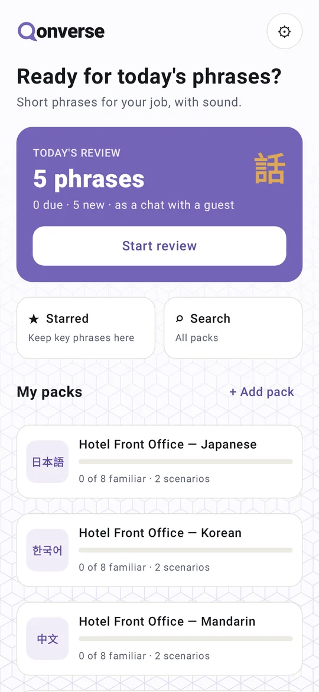
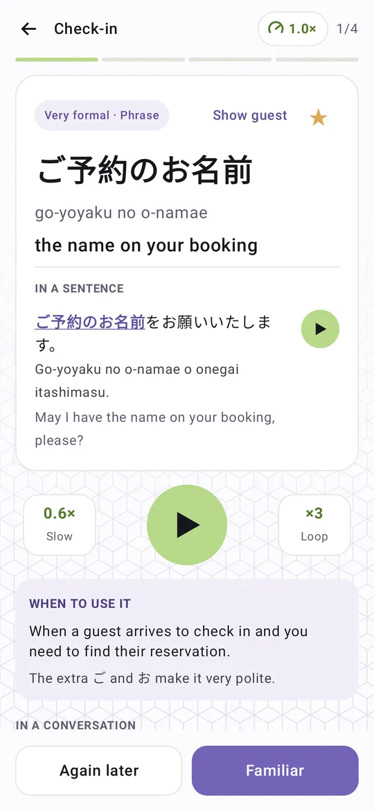
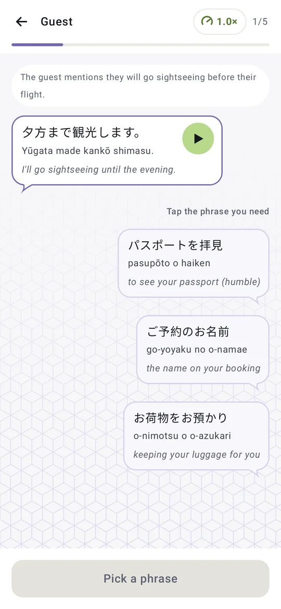
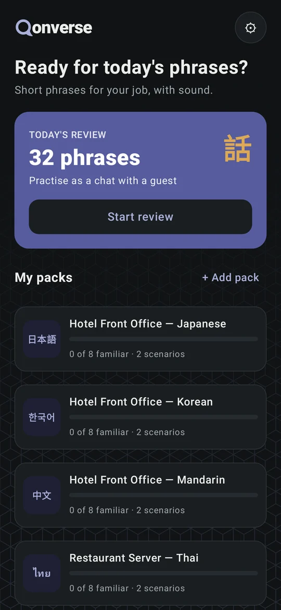

<p align="center"></p>

<h1 align="center">Qonverse</h1>

<p align="center"><b>Learn the phrases your job needs — in any language.</b><br>
A free, open source app for working people — front desk, restaurant floor, shop, ward or taxi.<br>
Android app, plus a web app for iPhone, iPad and any browser. <b>Preview release.</b></p>

<p align="center">
  <a href="https://aadvark.github.io/Qonverse/">Website</a> ·
  <a href="https://github.com/aadvark/Qonverse/raw/main/docs/download/Qonverse-0.2.0.apk">Download APK</a> ·
  <a href="https://aadvark.github.io/Qonverse/docs/app/">Web app (iPhone &amp; any browser)</a> ·
  <a href="prompts/pack-generator-prompt.md">Pack prompt</a> ·
  <a href="docs/pack-format.md">Pack format</a>
</p>

<p align="center">
  
  
  
  
</p>

## How it works

1. **Copy the Qonverse prompt** ([`prompts/pack-generator-prompt.md`](prompts/pack-generator-prompt.md)) into any AI chat — Claude, ChatGPT, Gemini or a local model.
2. **Answer its questions** about your job, the language you need and the situations you face. It writes a *scenario pack*: short phrases with transliteration, meaning, an example sentence, a mini conversation and likely replies.
3. **Paste the pack into Qonverse** (or import a `.json` file). Listen, slow it down, loop it, imitate it, then practise in a chat with a guest.

Qonverse itself runs no AI and needs no account or API key.

## Features

- **Phrases, not sentences** — reusable chunks such as ご予約のお名前 *(go-yoyaku no o-namae, "the name on your booking")*, each shown in a full sentence and a real conversation.
- **Transliteration and meaning, always** — every line in a non-Latin script comes with English letters and its meaning.
- **Listen and imitate** — normal, slow (0.6×) and loop ×3 playback for every phrase, sentence and reply.
- **Chat-style review with spaced repetition** — the guest speaks; you tap the phrase you need. Missed phrases come back sooner, known ones later.
- **Show guest** — flip a phrase into large print to show across the counter.
- **Starred phrases and search** across all packs, in English or the other language.
- **Pronunciation check** with the device's speech recognition.
- **Hands-free shadow mode** — plays each phrase, pauses for you to repeat, moves on.
- **Speed button** on every learning screen (0.6×–1.2×).
- **Backup & restore** in one file that moves between Android and the web app ([format](docs/backup-format.md)).
- **Daily reminder and a phrase-of-the-day widget** (Android).
- **Phone voices** — uses the phone's own free text-to-speech engine, with up to four voices per language. Nothing is bundled or recorded.
- **Day, dark and AMOLED themes**, offline use, and packs you can share as files.
- **Updates itself** — the Android app checks `docs/version.json` each time it opens and offers the new APK; the web app always loads the latest version when online.

## Web app (iPhone, iPad, any browser)

[`docs/app/`](docs/app) is the same app as a progressive web app: open it in Safari and choose **Share › Add to Home Screen**. It uses the browser's built-in voices, works offline after the first visit, and keeps packs and progress in the browser.

## Sample packs

Four sample packs are built into the app and live in [`packs/`](packs):

| Pack | Language | Phrases |
|---|---|---|
| [Hotel Front Office — Japanese](packs/hotel-front-office-ja.json) | ja-JP | 8 |
| [Hotel Front Office — Mandarin](packs/hotel-front-office-zh.json) | zh-CN | 8 |
| [Hotel Front Office — Korean](packs/hotel-front-office-ko.json) | ko-KR | 8 |
| [Restaurant Server — Thai](packs/restaurant-server-th.json) | th-TH | 8 |

They are samples: please have a native speaker review them before relying on them at work. Pull requests with corrections and new packs are very welcome.

## Building

Requirements: JDK 17+ and the Android SDK (platform 35).

```bash
./gradlew assembleRelease          # APK in app/build/outputs/apk/release/
./gradlew recordRoborazziDebug     # screenshots of the main screens in app/build/screens/
python3 site-src/build_site.py     # rebuild the landing page in docs/
```

Preview APKs are signed with the Qonverse preview key (set `QONVERSE_KEYSTORE` to its path) so in-app updates install over each other. For Google Play, sign with your own upload key and turn off the in-app updater.

To publish an update: bump `versionCode`/`versionName` in `app/build.gradle.kts`, build, copy the APK to `docs/download/Qonverse-<version>.apk`, edit `site-src/release-notes.txt`, run `python3 site-src/build_site.py`, then commit and push. Installed apps pick it up the next time they open.

Every push also builds the APK on GitHub Actions as a check.

## Project layout

```
app/        Android app (Kotlin, Jetpack Compose)
packs/      Sample scenario packs (format v1.2)
prompts/    The AI prompt that writes packs
schema/     JSON Schema for packs
docs/       Website (GitHub Pages): landing page, web app (docs/app), APK, version.json
design/     Logo, app icon and palette
site-src/   Landing page template and build script
```

## Licence

Apache License 2.0 — see [LICENSE](LICENSE).

Made by Lee Wen Yang (Mike) · Kith + Keen.
